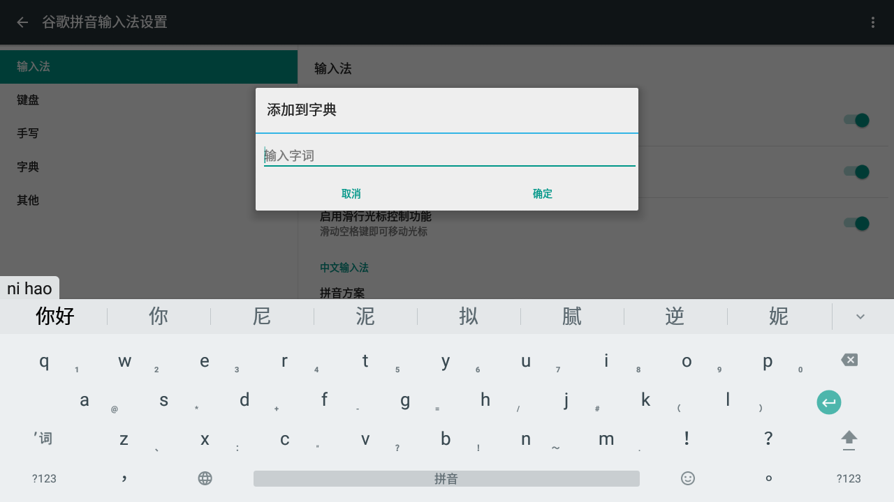
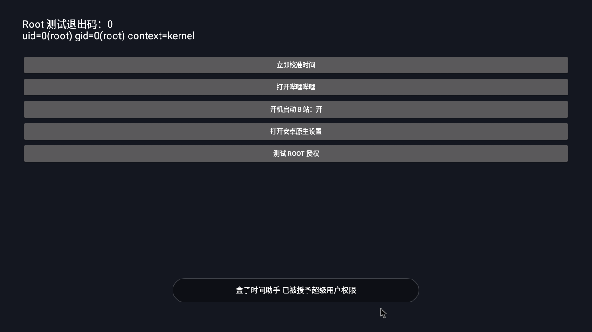

# DM4036

> 将大麦盒子变成陈睿盒子。

把退役的大麦 DM4036 改造成以第三方哔哩哔哩客户端为入口、支持自选桌面和软件的电视盒子。这里公开 2026 年 11 月 10 日在一台 **PB70.51.02 / Android 5.1.1 / 三星 eMMC** 机器上的研究、代码、配置和验证结果。

这次选择修复原系统：**开机进 B 站，HOME 回 FLauncher，设置打开安卓原生设置**。没有刷入更高版本 Android，也没有修改 boot、recovery、bootloader 或 logo 分区。

## 直接阅读与下载

- **[完整实机研究与操作手册](docs/research-2026-11-10.md)**：硬件、首次提权、永久 root、授权管理、去广告、校时、证书、解码修复、输入法和恢复方法。
- **[软件目录](docs/software.md)**：用到的软件、精确版本、来源、校验值及分发范围。
- **[研究与软件 Release](https://github.com/HachiMiku39/DM4036/releases/tag/research-2026-11-10)**：助手 APK、源码快照及可再分发的软件附件。
- **[给下一位 AI 的入口](docs/AI-HANDOFF.md)**：先读现状与限制，再决定下一步。

## 实际改了什么

| 项目 | 结果 |
|---|---|
| B 站播放 | BLBL 0.1.29 + 作者 IJK ARMv7 插件；绕过原系统损坏的 AAC OMX 初始化路径 |
| 开机与 HOME | 校时后自动打开 BLBL；HOME 回 FLauncher 0.18.0 |
| 设置 | 关闭厂商框架的设置拦截，恢复 `com.android.settings/.Settings` |
| root | Magisk 23 配套 su/daemon，沿用原机 init 启动钩子；普通应用由管理器授权 |
| 时间 | 阿里云 NTP、上海时区、开机与每六小时校时 |
| 证书 | 备份后补入 ISRG、GTS 等官方根证书；Android 默认 TLS 校验实测通过 |
| 联网检测 | 改用实测返回 HTTP 204 的小米地址 |
| 厂商广告与应用 | 处理 37 个包、移走 23 个预装目录，保留投屏、遥控和必要控制支持 |
| 启动画面 | 备份并移除厂商动画/视频，关闭厂商 bootvideo 模式；上电第一帧 logo 未修改 |
| 浏览器 | Firefox 143.0.4 ARMv7；软件渲染设置后可显示 HTTPS 网页 |
| 中文输入 | 谷歌拼音 4.5.2 ARMv7，已设默认；`nihao` 实测显示“你好”候选 |
| 商店 | 酷安 13.3 已安装；首次协议由设备所有者在应用中选择 |





## 适用范围

实机为 S905-B / GXBB p200、约 1 GB RAM、三星 8 GB eMMC，应用 ABI 是 **32 位 `armeabi-v7a`**。当前显示器为 1080p60，安卓 UI 逻辑尺寸为 1280×720。不能因为 CPU 支持 64 位，就选择 arm64-only APK。

这是旧系统的软件改造记录，不是通用刷机包。三星/金士顿固件不能混用；历史 Android、浏览器和输入法也不等同于仍受支持的现代系统。“去广告”指移除大麦系统层的广告，不保证第三方应用或视频内容本身没有推广。

## 代码目录

```text
helper/                    自编译校时、启动和诊断助手
scripts/device.py          可配置设备地址的 ADB 控制器
scripts/root-start.sh      本机最终采用的开机脚本参考
scripts/firefox-user.js    旧 Mali GPU 的 Firefox 兼容配置
research/session-scripts/  研究过程中用过的历史脚本，先读该目录 README
research/vendor-app-packages.json  本次厂商包与原路径清单
certs/                     从 CA 官方源取得的公共根证书
checksums/                 研究资产与 Release 附件的 SHA-256
third_party/               软件许可和对应源码入口
docs/                      完整研究、软件清单和交接说明
```

这些代码不会在克隆后自动连接设备或执行 root。先安装 [官方 Platform Tools](https://developer.android.com/tools/releases/platform-tools)，明确选择自己的设备：

```sh
export DM4036_DEVICE='BOX_IP:5555'  # 把 BOX_IP 换成盒子的实际地址
export DM4036_ADB='adb'
export DM4036_ADB_SERVER_PORT='5038'
python3 scripts/device.py shell 'getprop ro.product.model; getprop ro.build.version.release; date'
```

首次提权与已 root 后的维护是两个阶段。**不要把 `research/session-scripts` 当作一键安装器运行**：里面保留了固定 UID/路径、阶段性绕行和已知失败方法，具体解释见完整手册。

## 验证边界

已验证重启后的 B 站自启、HOME、原生设置、root、授权弹窗、NTP、TLS、视频画面/音频和中文候选。投屏包与控制依赖保留，但没有做手机到盒子的端到端投屏测试；启动早期画面没有录像验收。酷安下载服务也没有在同意其首次条款前代用户完成测试。

软件二进制仅在许可明确时镜像；其他软件提供原来源和完整校验值。[第三方说明](third_party/README.md)列出原许可与对应源码。仓库不包含设备密钥、账号 Cookie、签名私钥、实际局域网地址、厂商 ROM、用户数据或原厂分区镜像。

本项目为个人研究记录，与大麦、哔哩哔哩及相关个人没有隶属或背书关系。新增原创代码采用 MIT；第三方软件和证书保留各自权利及许可。
